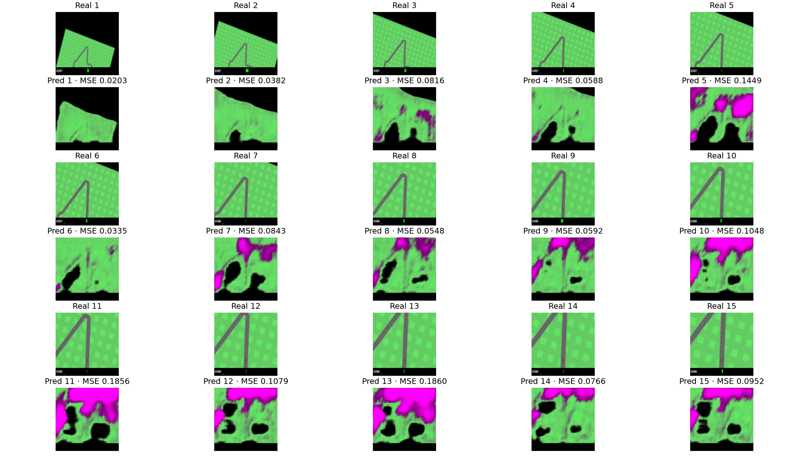
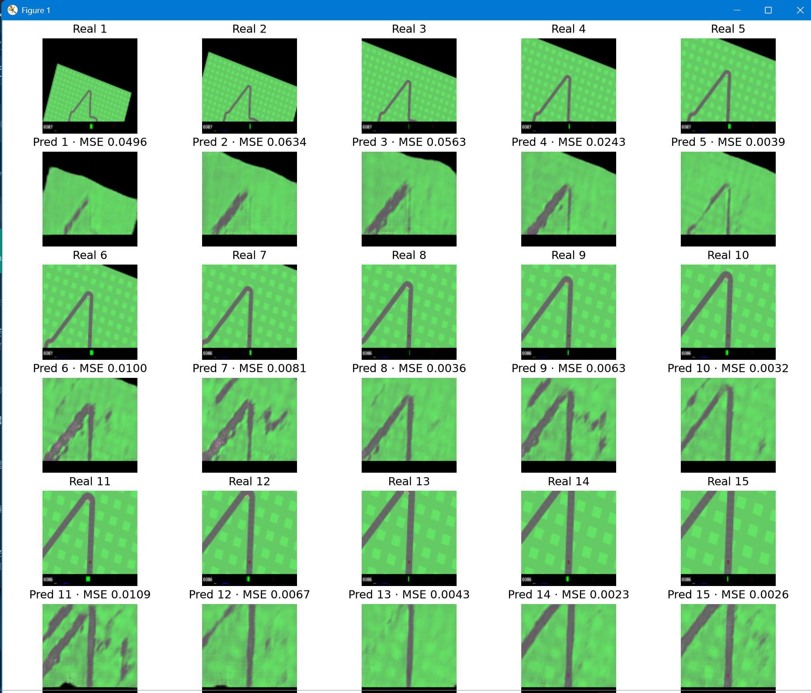
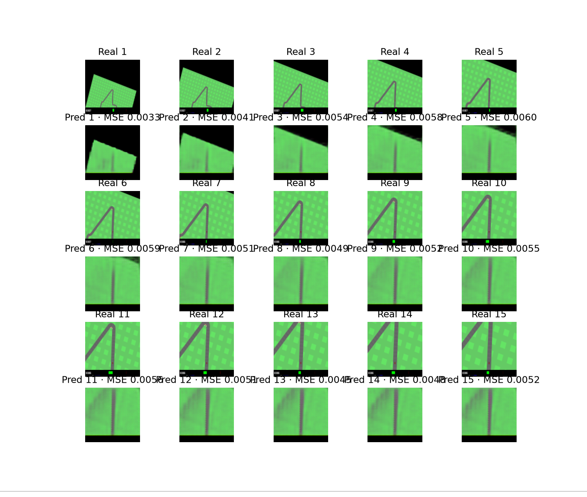

##### 1. 用RSSM输入与游戏环境下相同的连续动作，预测了16帧图片

大概10帧之后就面目全非。
不知为何，重训反而像样子：

| 比较维度 | Dynamics Learning | Behavior Learning |
| --- | --- | --- |
| 学习对象 | 环境转移规律 | 智能体决策策略 |
| 主要网络 | Dynamics Model | Actor、Critic |
| 主要输入 | 状态与动作 | 当前状态 |
| 主要输出 | 下一状态的预测分布 | 动作分布、状态价值 |
| 学习目标 | 提高环境预测准确性 | 最大化长期回报 |
| 典型训练方式 | 预测学习、KL 优化等 | Actor-Critic、策略梯度 |
| 是否需要奖励 | 纯动力学预测不一定需要 | 任务型强化学习通常需要' |

让先验与后验z相互学习，可以做到在250 episodes 稳定达到效果：
